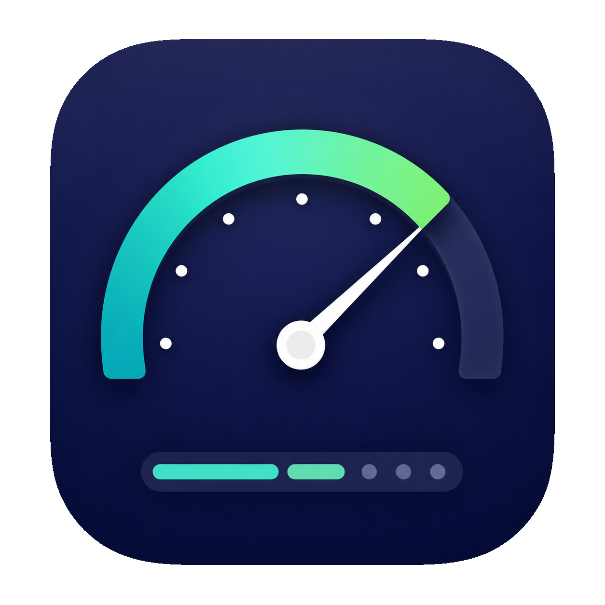
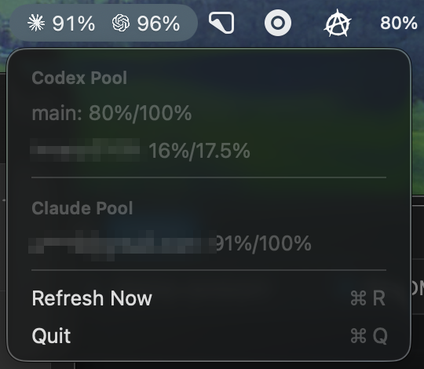

<p align="center">
  
</p>

# OpenCodex Quota Tray

Native macOS 14+ menu-bar app. Reads the weighted pool view from
[OpenCodex](https://github.com/lidge-jun/opencodex) once a minute and shows how
much Codex, Claude, and Z.ai allowance is left. It never mutates account state.

Every number comes from OpenCodex's `GET /api/quota-pool/tray` read
(`ocx.quota-tray/1`): pooled remaining per window, plan units, blocked state,
recovery times, and reset credits. The tray only floors percentages and formats
durations; it does no quota math, plan weighting, or calibration. It therefore
needs an OpenCodex build that serves that route.



## Menu-bar label

The label stays quiet unless something changed:

- A provider whose pooled 5-hour and weekly remaining are both above `95%` is
  never shown.
- Otherwise its icon and floored `5h/weekly` remaining (for example `38%/99%`)
  appear for one minute whenever that text differs from what was last shown,
  including the first read below `95%`.
- When OpenCodex reports the provider blocked (the 5-hour or weekly window is
  spent on every account), it stays shown as `0%/0%` with the time until the
  nearest recovery: `2d 3h` for a weekly block, `1h30m` for a 5-hour one. A
  weekly block also shows the reset ticket when a banked reset is available.

Providers without a 5-hour window show a single weekly number. With nothing to
show, a small chart icon keeps the menu reachable.

## Dropdown

Each provider gets a section with one row per account, then its recovery row:

```text
Codex 30%/90%
  alex@examp [prolite x10] 30%/90%   🎟 x2, 2d3h
  work [plus x1] 7%/40%
  5h/7d recovery: 1h30m (+30%) | 4h9m (+10%)
```

- The account name is cut at the first space or 10 characters.
- `[plan xN]` is the plan and its basic units as OpenCodex weights them.
- Usage is 5-hour/weekly remaining; accounts or providers without a 5-hour
  window show only the weekly number, and the recovery row becomes
  `7d recovery: …`.
- The ticket shows banked reset count and time to the soonest expiry. OpenCodex
  learns expiry dates in the background, so a fresh count can appear without
  an expiry first.
- Paused and reauth accounts are marked inline.

`Refresh Now`, `Launch at Login`, and `Quit` sit below the sections.

## Refresh and cost

One timer drives everything: one HTTP read per minute in steady state, and the
label and countdowns update on the same tick. Host role and enrollment are
checked once and reused until the local OpenCodex config changes or a read
fails. Concurrent refresh requests are coalesced.

## Configure

Finder-launched apps do not reliably inherit shell environment. Optionally
create `~/.config/opencodex-quota-tray/config.json`:

```json
{
  "pollIntervalMS": 60000,
  "requestTimeoutMS": 30000
}
```

Environment variables override config-file values:

| Variable | Default |
| --- | --- |
| `POLL_INTERVAL_MS` | `60000` (values below a minute are raised to it; the label and countdowns still update every minute) |
| `REQUEST_TIMEOUT_MS` | `30000` |
| `OPENCODEX_BASE_URL` | `http://127.0.0.1:10100` |
| `OPENCODEX_HOME` | `$HOME/.opencodex` |

Standalone and Home hosts read `/api/quota-pool/tray` locally with
`admin-api-token`. Link clients read the Home's view through
`/api/machine/hub-relay/api/quota-pool/tray` with their enrolled credentials.
Direct Hub clients are not supported: the tray shows an error asking to connect
with Link.
HTTPS is required for remote origins, and credentialed requests refuse
redirects.

## Develop

```bash
swift test
swift run OpenCodexTray
```

## Build app

Local builds use an ad-hoc signature and do not contact Apple:

```bash
./scripts/build-app.sh
open dist/OpenCodexTray.app
```

Trusted direct distribution requires the local Developer ID identity and a
one-time Notary service Keychain profile:

```bash
xcrun notarytool store-credentials "YOUR_NOTARY_PROFILE" \
  --apple-id "YOUR_APPLE_ACCOUNT" \
  --team-id "YOUR_TEAM_ID"
```

Enter an app-specific password when prompted. Copy `.env.example` to `.env`
and replace its placeholders with your local signing identity and Keychain
profile. `.env` is ignored by Git.

The build reads only `SIGNING_IDENTITY` and `NOTARY_PROFILE` from `.env` as
literal values; it does not execute the file as shell code.

```bash
cp .env.example .env
NOTARIZE=1 ./scripts/build-app.sh
```

This signs, notarizes, staples, and verifies the release. The distributable
artifact is `dist/OpenCodexTray.zip`. Environment variables override values
loaded from `.env`.

## License

MIT, see [LICENSE](LICENSE).

Bundled CodexBar provider icons are MIT-licensed by Peter Steinberger, see
[Sources/OpenCodexTray/Resources/CodexBar-LICENSE.txt](Sources/OpenCodexTray/Resources/CodexBar-LICENSE.txt).
